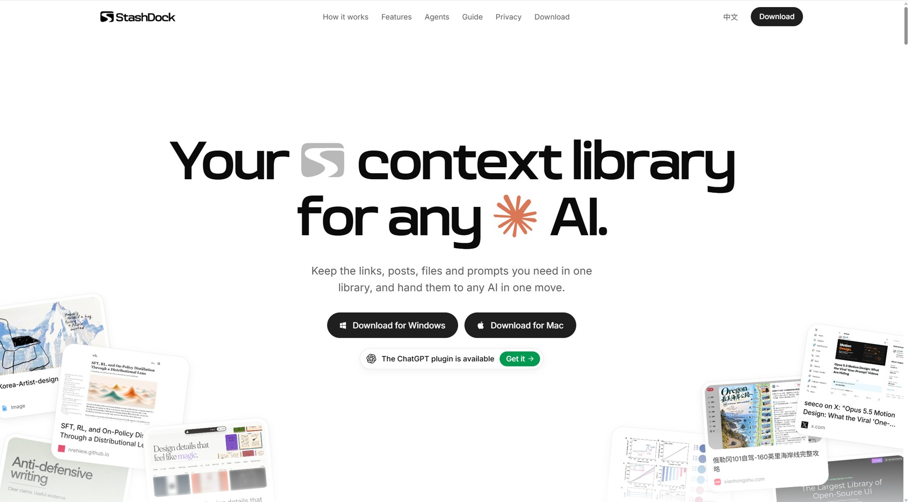
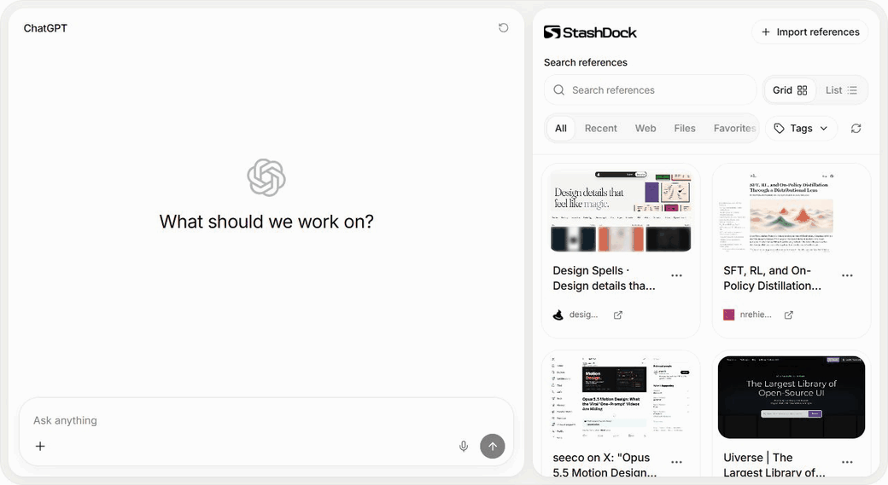
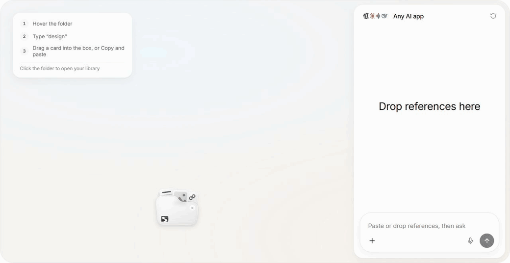

  

English · <a href="README.zh-CN.md">简体中文</a>

<h1 align="center">Your context, ready for any AI.</h1>

  An AI-native, local personal context library. 
  Bring your links, files, prompts and rules together. Find what matters, and put it to work in your next conversation.

  <a href="https://stashdock.app"><strong>Website</strong></a> ·
  <a href="https://github.com/StashDock/StashDock/releases/tag/v1.0.0"><strong>Download 1.0.0</strong></a> ·
  <a href="https://stashdock.app/guide">Guide</a> ·
  <a href="https://github.com/StashDock/StashDock/issues">Feedback</a>

## Keep the context. Skip the search.

Good references are scattered across browser tabs, folders and past conversations.
StashDock brings them into one visual library you can search, organize and reuse.

Save pages with the Chrome extension, import bookmarks, or add local files,
notes, prompts and rules. Group references with tags, edit the context you want
AI to receive, and use the same collection across conversations.

## Beside your AI conversation

Open your library in the AI app's sidebar. Select references and choose
**Add to chat**. The AI plugin is currently available for **ChatGPT**.

## On your desktop, into any AI

Copy or drag references into any AI conversation. Hover the floating folder to
search, or click it to open your full library.

*Product previews use sample references. [Try them on the website](https://stashdock.app/#how).*

## Let AI work with your library

Through MCP and its included skill, StashDock gives AI a useful role on both
sides of the conversation: bringing saved context in, and saving useful context
for next time.

- **Find the right starting point.** “Find references in my library that could help with this project.”
- **Keep what you learned.** “Save the writing rules we agreed on as a reusable reference.”
- **Organize as you go.** “Suggest tags for these references and show me the plan before applying it.”

Reuse a tag as a context set, build a project reference shelf, or carry your
preferred prompts and rules between AI apps. Start with your own workflow.

## Get StashDock

| | Desktop | ChatGPT plugin |
| --- | --- | --- |
| **Windows** · Windows 10/11, x64 | [Download installer](https://github.com/StashDock/StashDock/releases/download/v1.0.0/StashDock_1.0.0_x64-setup.exe) | [Download plugin](https://github.com/StashDock/StashDock/releases/download/v1.0.0/stashdock-plugin-1.0.0-win32-x64.zip) |
| **Mac** · macOS 14+, Apple Silicon | [Download DMG](https://github.com/StashDock/StashDock/releases/download/v1.0.0/StashDock_1.0.0_aarch64.dmg) | [Download plugin](https://github.com/StashDock/StashDock/releases/download/v1.0.0/stashdock-plugin-1.0.0-darwin-arm64.zip) |

[Add to Chrome](https://chromewebstore.google.com/detail/bbglcpbhnobjhgccjinejnnlcefelkee) · [Installation guide](https://stashdock.app/guide#install-browser)

Install Desktop, the AI plugin, or both. They share one library on your computer.
Install and open either once to enable Chrome page saving, which works even when
Desktop and the AI app are closed.

The installers are not signed by a registered developer; the Mac app is not
notarized. Windows may show SmartScreen. If macOS blocks the first launch,
open **System Settings → Privacy & Security → Open Anyway**.

## Yours to keep

Your library is stored on your device. You choose what to save and what to give
AI. Different computers do not sync automatically.

[MIT license](LICENSE) · [Third-party notices](THIRD_PARTY_NOTICES.md) ·
[Privacy](https://stashdock.app/privacy)
